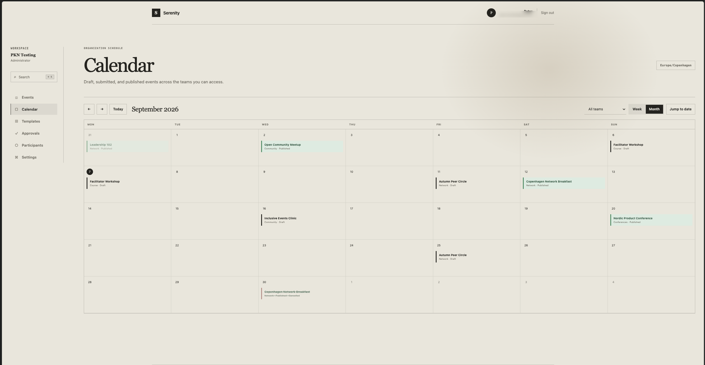
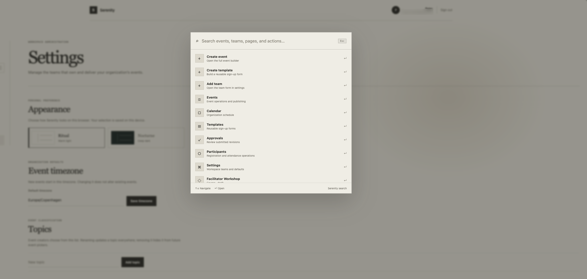

# Serenity

Serenity is an event management platform for teams that plan, review, and publish events. It keeps schedules, reusable sign-up forms, approvals, and participant registrations in one workspace.

Teams can prepare event revisions without changing the live event, then submit them for approval. Once approved, the published event and its sign-up form are available through an embeddable form or a JSON API.

## Screenshots

### Calendar



### Command palette



## Tech stack

- SolidJS and TypeScript for the frontend
- Convex for the backend and real-time data
- Confect and Effect for domain services
- WorkOS AuthKit for authentication
- Vite+ for development, testing, and builds

## Run it locally

```sh
vp install
```

Start Convex and follow its prompts to connect your Convex and WorkOS accounts. This creates the local environment configuration:

```sh
vp run convex:dev
```

Keep that process running. In another terminal, start the app and open the URL it prints:

```sh
vp dev
```
